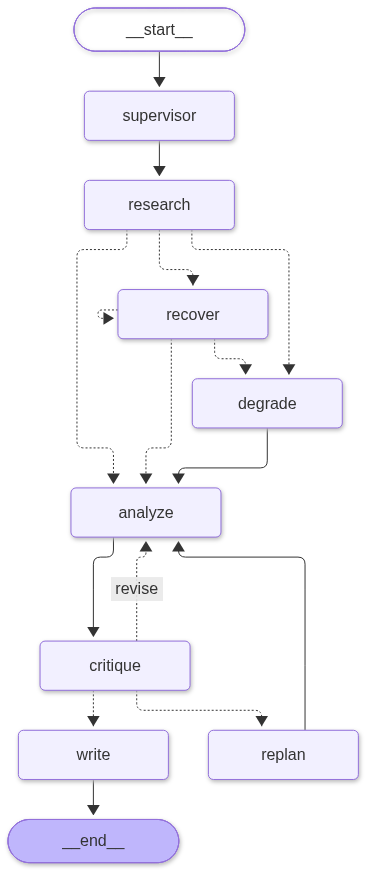

# Maestro

[](https://github.com/krishivsaini/Maestro/actions/workflows/tests.yml)


[](https://maestro-bb8l.onrender.com)

**A multi-agent research system where the agents check each other's work, and every decision is visible.**

Give Maestro a hard question (*"Compare PostgreSQL and MongoDB for a startup's first product, and
recommend one"*). A supervisor plans the research at runtime, researchers read real web pages in
parallel, an analyst drafts a cited argument, a critic verifies every claim against its evidence and
sends the work back when it falls short, and a writer produces the final brief. You watch all of it
stream live.

https://github.com/user-attachments/assets/4956f815-f2f3-4dc4-a0ac-8a024fb712ee

**[Live demo](https://maestro-bb8l.onrender.com)** &nbsp;·&nbsp; **[Architecture](ARCHITECTURE.md)** &nbsp;·&nbsp;
**[How it works](#how-it-works)** &nbsp;·&nbsp; **[Engineering decisions](#engineering-decisions)** &nbsp;·&nbsp;
**[Run it](#run-it-locally)**

<sub>The demo runs on free tiers: the first request after 15 idle minutes takes about a minute to wake the server.</sub>

---

## Why it exists

Ask one LLM prompt for a cited brief and you get confident text with citations nobody checked. Maestro
treats that as a coordination problem: split the work across specialists with separate contexts, make
one of them an adversarial reviewer whose verdict is computed in code, and make every hand-off,
rejection and recovery an observable, replayable event.

The question type was chosen because it genuinely decomposes: independent research parallelizes, the
analysis depends on it, the critique can send the analysis back, and composition comes last. The
multi-agent structure is load-bearing, not decoration.

## Results

Every number here comes from a script or test in this repo.

| What was measured | Result |
|---|---|
| Critic: drafts with one planted flaw each, caught | **20 / 20** (the earlier PASS/REJECT critic: 12 / 20), with every correct draft still passed |
| Critic on a held-out topic it was never tuned on | **5 / 5** (earlier critic: 3 / 5) |
| Memory: follow-ups worded differently from their findings | right finding ranked first **12 / 12** by meaning vs **1 / 12** by word matching (MRR 1.00 vs 0.36) |
| Reading pages instead of search snippets | findings that carry real figures: **37% → 70%** on the solar question; 20 of 29 real result pages readable |
| Cost of a typical run | **6 model calls, ~11k tokens**, broken down per agent in the viewer |
| Tests | **176 offline** + Postgres variants + **3 recorded live runs replayed** on every push in CI |

---

## How it works



```
START → supervisor → research ─┬─▶ analyze ─▶ critique ─┬─(PASS / ceiling)─────────────▶ write → END
                               │       ▲                ├─(REJECT, rewrite can fix it)─▶ analyze
                    (failed)   ├─▶ recover ⟳ (retry)    └─(REJECT, evidence missing)──▶ replan
                               │       │                                                  │
                    (exhausted)└─▶ degrade ─▶ analyze ◀───── new research, then revise ───┘
```

| Node | Role |
|---|---|
| `supervisor` | Decomposes the goal into a validated `Plan` (subtasks, roles, dependencies, search queries); recalls the thread's memory |
| `research` | Fans out researcher subtasks on a bounded thread pool; each searches, reads the top pages, and returns grounded findings |
| `recover` / `degrade` | The recovery ladder for a failed researcher: retry, re-delegate, then continue on partial evidence, flagged |
| `analyze` | Drafts claims, each citing numbered evidence; revises against the critic's numbered issues |
| `critique` | Code checks plus a claim-by-claim model review; the verdict is computed in code |
| `replan` | Adds new researcher subtasks mid-run when the critic finds a gap only new evidence can fill |
| `write` | Composes the brief, drops claims the critic found unsupported, states open issues as caveats |

Five agents (supervisor + four specialists), each with its own prompt and context; the only thing they
share is typed state passed through the supervisor. Every arrow above is a real LangGraph edge, every
transition is a `TraceEvent` streamed over SSE, and every node is checkpointed.

**Why LangGraph:** the supervisor pattern *is* a graph: a controller routing between specialists over
typed state, with conditional edges for delegation, critique and recovery. Building that by hand means
reinventing a state machine with persistence; using one let the work go into making the coordination
correct, observable and recoverable. More in **[ARCHITECTURE.md](ARCHITECTURE.md)**.

---

## Engineering decisions

### 1. A critic whose verdict is computed, not vibed
An LLM asked "is this good? PASS/REJECT" approves too much and is inconsistent. So the critic is split
in two. **Code** first checks what needs no model: uncited claims, citations to evidence that doesn't
exist, figures that don't appear in the evidence they cite, a missing recommendation. Then **the model**
grades every claim against its cited evidence (supported, partial, overstated, miscited, unsupported,
contradicted) and raises issues by severity. **The verdict is decided in code** from those findings: any
blocker, or two majors, rejects.

Re-reviews track issue ids, so the critic must confirm each fix and can't move the goalposts (it may only
add new blockers), and a revision that fixes nothing stops the loop instead of burning quota. Evaluated
on a seeded-flaw set with a held-out topic ([results](#critic-evaluation)).

### 2. The critic can send work back to research, not just to rewrite
Some flaws can't be fixed by rewording; the evidence simply isn't there. The critic can attach a research
question to an issue, and the `replan` node adds researcher subtasks for it mid-run, appends their
evidence, and has the analyst revise. Bounded (`MAX_REPLANS=1`, at most 2 questions) so cost stays
predictable.

### 3. Grounded research, and web text treated as hostile
The planner writes 1-3 search queries per researcher; results are merged, the top pages are fetched and
extracted with the standard library, and only passages relevant to the question are kept (falling back
to the snippet when a page blocks readers or is a PDF). A finding is dropped unless its source is one of
the results the researcher was actually shown, so researchers can't invent sources.

Pages are third-party input to an LLM, so sentences addressing an AI ("ignore previous instructions…")
are stripped before a researcher sees them, pages are wrapped in untrusted-content markers, and any
finding that still carries instructions is discarded.

### 4. Failures are expected, bounded and visible
Tools return structured failures instead of raising into the graph. A failing researcher climbs a logged
ladder (retry → re-delegate → degrade) and the run completes on partial evidence, marked `degraded`
rather than silently wrong. Every model and tool call has exponential backoff with jitter for 429s and
transient 5xx/network errors (added after a real Gemini 503), and a step budget plus stall and repeat
detectors guarantee a run can't spiral.

### 5. Human in the loop, and runs that survive failure
Every node is checkpointed (Postgres in production, SQLite locally). That buys two features from one
mechanism:
- **Plan review:** the graph is compiled with `interrupt_before=["research"]`. A person can edit, remove
  or add research questions, and the same run continues with the edits validated against the plan.
- **Resume:** a run that dies partway (say, quota runs out at the analyst) offers *Resume* and continues
  from its last finished node, without redoing planning or research. Both go through `POST /runs/{id}/resume`.

### 6. Memory that recalls by meaning, and degrades instead of failing
Findings are saved per conversation thread and recalled when planning a follow-up. Each finding stores a
Gemini embedding (documents and queries embedded asymmetrically, vectors tagged by model so different
models are never compared) plus a cheap word vector. If the embedding API is down, recall falls back to
words rather than failing the run. No vector extension is needed: a thread holds a handful of findings,
ranked in numpy, so any Postgres works.

### 7. Guardrails on follow-up questions
A follow-up re-runs the whole pipeline, so an off-topic one wastes ~8 calls and produces a brief that
pretends to build on unrelated research. A free term-overlap check passes clear cases; otherwise one
temperature-0 model call decides. Steering attempts always get the model check. If the guard itself
fails it lets the question through, since a guard outage shouldn't block a legitimate question.

### 8. Cost is a first-class output
Every model call is metered at the client boundary: agent, model, input/output tokens, latency, success
(failed retries included), plus embedding calls. The breakdown streams with the result, is stored with
the run, and appears in the viewer. A dollar estimate is shown only when per-token prices are configured;
nothing is assumed.

### 9. Testing real model behavior, not just stubs
Stubbed tests prove the mechanics but not that the code still behaves on real model output.
`scripts/record_run.py` records a live run at the model, search and page boundaries into a **cassette**
with no secrets. `tests/test_replays.py` replays each cassette through the current code in about a
second, with planning validation, scheduling, grounding, the critic's decision and routing all running
for real. If a change makes the code decide differently on the same model output, the test names exactly
what changed. A missing recording raises a `BaseException`, so the recovery ladder can't quietly absorb
it.

### 10. Built to be left running in public
The demo uses a shared free API key, so it's protected before any model call: per-IP sliding-window
limits (6/hour; more with your own key), a shared daily cap, proxy-aware client IPs, and validated input
with messages a visitor can act on. A visitor's own key is used for their run only and never stored or
logged. Runs and memory live in Supabase Postgres; if the database is unreachable the service falls back
to local storage and says so on `/healthz` instead of failing to start.

---

## Real runs

All traces are real output from the system.

<details>
<summary><b>Dynamic decomposition, parallel research, memory</b></summary>

```
goal: Should a startup use PostgreSQL or MongoDB for its first product?
status=completed  subtasks=5  critic_iters=1  recoveries=0

  plan_produced       supervisor    planned 5 subtasks: ['research_postgres', 'research_mongodb', 'analyze_comparison', 'critique_analysis', 'write_brief']
  subtask_dispatched  researcher    (research_postgres)   dispatched research_postgres
  subtask_dispatched  researcher    (research_mongodb)    dispatched research_mongodb
  subagent_result     researcher    (research_mongodb)    research_mongodb -> done      # ran concurrently,
  subagent_result     researcher    (research_postgres)   research_postgres -> done     # max_concurrency=2
  subagent_result     analyst       (analyze_comparison)  analysis draft rev 0
  critic_pass         critic        (critique_analysis)   review 1: PASS
  subagent_result     writer        (write_brief)         final brief composed
  memory_write        supervisor    stored 5 finding(s) to long-term memory
  completed           supervisor    run completed (completed)
```
</details>

<details>
<summary><b>The critic overrules the analyst: reject → revise → pass</b></summary>

```
status=completed  subtasks=5  critic_iters=2  recoveries=0

  subagent_result   analyst   (analyze)    analysis draft rev 0
  critic_reject     critic    (critique)   review 1: REJECT      verdict=REJECT
  subagent_result   analyst   (analyze)    analysis draft rev 1   ← revised on the critic's feedback
  critic_pass       critic    (critique)   review 2: PASS         verdict=PASS
  subagent_result   writer    (write)      final brief composed
  completed         supervisor             run completed (completed)
```
</details>

<details>
<summary><b>A researcher keeps failing: retry → re-delegate → degrade, and the run still completes</b></summary>

```
status=degraded  subtasks=5  critic_iters=1  recoveries=2

  subagent_result     researcher  (research_1)   research_1 -> failed
  recovery            supervisor  (research_1)   recovery attempt 1 (retry)        decision=retry
  subagent_result     researcher  (research_1)   research_1 -> failed
  recovery            supervisor  (research_1)   recovery attempt 2 (re-delegate)  decision=re-delegate
  subagent_result     researcher  (research_1)   research_1 -> failed
  degraded            supervisor  (research_1)   degraded after exhausting recovery; proceeding on partial evidence
  subagent_result     analyst     (analyze)      analysis draft rev 0
  critic_pass         critic      (critique)     review 1: PASS
  completed           supervisor                 run completed (degraded)
```
</details>

Both failure paths can be triggered on demand: `MAESTRO_FORCE_CRITIC_REJECT=1`, `MAESTRO_FAULT_INJECTION=true`.

---

## Run it locally

Requires [`uv`](https://docs.astral.sh/uv/) and Python ≥ 3.11.

```bash
git clone https://github.com/krishivsaini/Maestro.git && cd Maestro
uv sync                                   # deterministic install from uv.lock

uv run pytest                             # offline, no API key: 176 passed, 8 skipped

cp .env.example .env                      # add a free GOOGLE_API_KEY
uv run uvicorn maestro.serve:create_app --factory
# open http://127.0.0.1:8000 and ask a question

uv run python scripts/demo_cases.py list           # scripted cases: parallelism, critic, recovery, memory...
uv run python scripts/demo_cases.py run crit-01    # watch a forced critic rejection
```

The model is swappable via `MAESTRO_MODEL_ID`: `gemini-3.5-flash-lite` by default (fast, and the free
tier's most generous quota), `gemini-3.6-flash` as the fuller alternative, switchable from the viewer
mid-run because the free tier meters each model separately.

---

## Testing and evaluation

`uv run pytest` runs **176 tests offline** (models stubbed, no key or quota). The Postgres variants run
when `MAESTRO_TEST_DATABASE_URL` is set, as they are in CI against a real Postgres 16 service. The hard
parts each have a proof: decomposition, parallelism (independent subtasks overlap, the cap is never
exceeded, dependents wait), the critic loop and structured review, replanning, recovery, loop control,
page reading, plan review and resume, cost metering, usage limits, storage, memory recall, guardrails
and citations.

### Recorded runs, replayed

```bash
python scripts/record_run.py "Compare solar and wind ..." --name solar-wind   # record a live run
python scripts/record_run.py --refresh solar-wind                            # accept a deliberate change
```

Three cassettes (`data/cassettes/`) replay on every push in GitHub Actions: no key, no quota.

### Critic evaluation

`scripts/critic_eval.py` runs a critic over `data/critic_eval_cases.json`: per topic, one draft that is
correct against its evidence and five copies with one planted flaw each (wrong citation, overclaim,
unsupported claim, contradiction, missing recommendation). A good critic rejects every flawed draft and
passes every clean one. The old critic is reproduced in the script and shown the same citations, so the
comparison measures the reviewing, not access to information.

| Critic (model) | Flaws caught | Clean drafts passed |
|---|---|---|
| Before: PASS/REJECT verdict (`gemini-3.5-flash-lite`) | 12 / 20 | 4 / 4 |
| Structured review (`gemini-3.5-flash-lite`, the default) | **20 / 20** | 4 / 4 |
| Structured review (`gemini-3.6-flash`) | 19 / 20 | 4 / 4 |

The old critic caught none of the wrong citations. One topic (`k8s-swarm`) was written after tuning on
the other three and run once, to check the result isn't fitted to the tuning set: the new critic caught
5/5, the old one 3/5.

`scripts/memory_eval.py` measures recall the same way, on 12 follow-ups phrased in different words from
the findings they should retrieve.

---

## Deploying

The service is one container: [`Dockerfile`](Dockerfile) builds it, [`render.yaml`](render.yaml) is a
one-click [Render](https://render.com) Blueprint. It needs a **long-lived container**, not serverless
functions, because `POST /run` streams SSE for the length of a multi-agent run.

```bash
docker build -t maestro . && docker run --rm -p 8000:8000 -e GOOGLE_API_KEY=... maestro
```

- **Durable storage:** set `DATABASE_URL` to any Postgres. On Supabase, use the **Session pooler**
  string, not the direct connection (IPv6-only on the free plan, unreachable from Render). Tables are
  created on first start; `GET /healthz` reports which storage is live (`"storage": "postgres"`).
- **Behind a proxy:** set `MAESTRO_TRUST_PROXY=true` so limits use the real client IP from
  `X-Forwarded-For`, and only behind a proxy, since anyone can send that header.
- **Limits:** `MAESTRO_RUN_LIMIT_PER_IP` (default 6/hour) and `MAESTRO_SHARED_DAILY_RUNS` (default 60).

<details>
<summary><b>Free-tier numbers, and hosting the viewer on a CDN</b></summary>

| | |
|---|---|
| **512MB RAM / 0.1 CPU** | A measured run peaks at ~187MB; the work is I/O-bound on Gemini, so the thin CPU only slows cold start. |
| **15-min idle spin-down** | The first visitor after a quiet spell waits ~1 min for the container to wake. |
| **Image size** | ~130MB compressed. The `embeddings` extra (sentence-transformers → torch) is left out because memory embeds through the Gemini API; `uv sync --extra embeddings` embeds locally instead. |

The viewer is one static file with no build step, so it can live on a CDN (Cloudflare Pages, Netlify)
and load instantly even while the backend wakes, showing *"warming the orchestra… 12s"* instead of
hanging. Set the API origin in `viewer/config.js`, and set `MAESTRO_CORS_ORIGINS` on the API to the
static host's origin. `?api=<origin>` points any copy of the page at a backend without editing it.
FastAPI still serves the viewer at `/`, so none of this is required.
</details>

---

## Trade-offs and limitations

Deliberate scope choices, stated plainly:

- **Retrieval is web search plus page reading, not a RAG pipeline.** Pages that block automated readers,
  need JavaScript, or are PDFs fall back to their search snippet (9 of 29 in a sample).
- **Parallelism is capped at 2** because the free tier allows only a few requests a minute and a run
  makes 6-10 calls. The scheduler is real and bounded; on a paid tier only the number changes.
- **Evaluation is targeted, not a benchmark.** The critic and memory have seeded evaluation sets; final
  brief quality is still judged by hand.
- **One domain.** The orchestration generalizes; the prompts are written for analytical briefs.
- **One instance.** Usage limits are counted in memory, which is right for a single container; several
  would need a shared counter (e.g. Redis). Checkpoints of a paused run nobody returns to aren't yet
  garbage-collected.

---

## Repository map

```
maestro/
  graph.py           StateGraph: nodes, routing, replan, plan edits, checkpoints
  supervisor.py      planning and plan validation
  scheduler.py       bounded parallel execution of subtasks
  agents/            researcher, analyst, critic, writer
  tools/             web search, page fetching and extraction
  memory/            thread memory (Postgres/SQLite, Gemini embeddings + word fallback)
  guard.py           follow-up guardrail
  resilience.py      backoff and retry
  loop_control.py    step budget, stall and repeat detection
  usage.py           per-call cost metering
  cassette.py        record and replay live runs
  limits.py          per-visitor and daily usage limits
  db.py              one storage seam over SQLite and Postgres
  serve.py           FastAPI: SSE streaming, resume, threads, health
viewer/index.html    the live viewer (single file, no build)
scripts/             record_run, critic_eval, memory_eval, demo_cases, render_graph
tests/               offline suite, Postgres variants, cassette replays
```

**Stack:** Python 3.11 · LangGraph · FastAPI (SSE) · Gemini · Pydantic · PostgreSQL (Supabase) / SQLite ·
numpy · tenacity · pytest · GitHub Actions · Docker · Render
